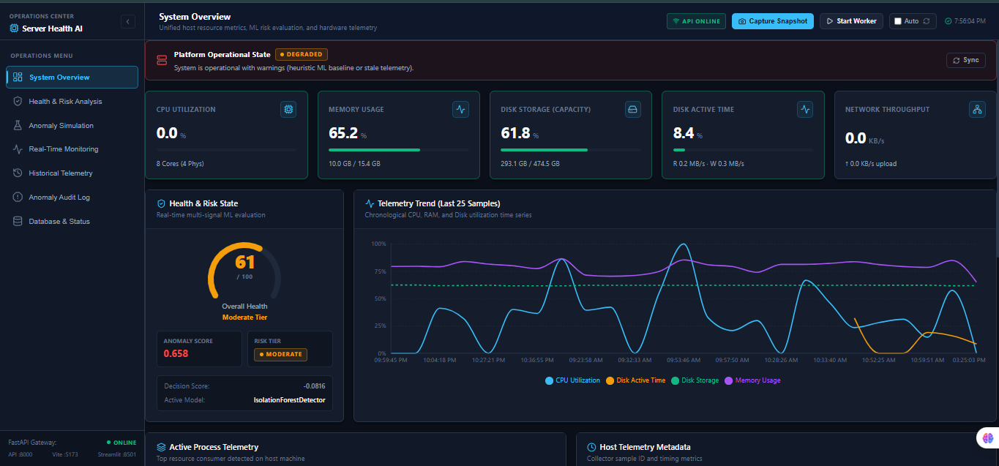
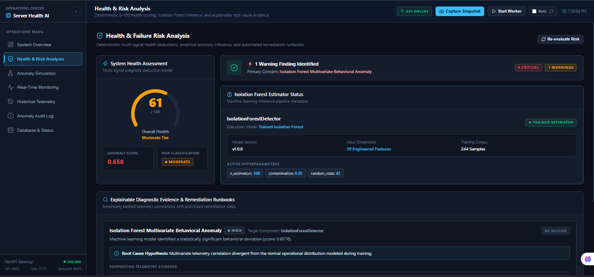
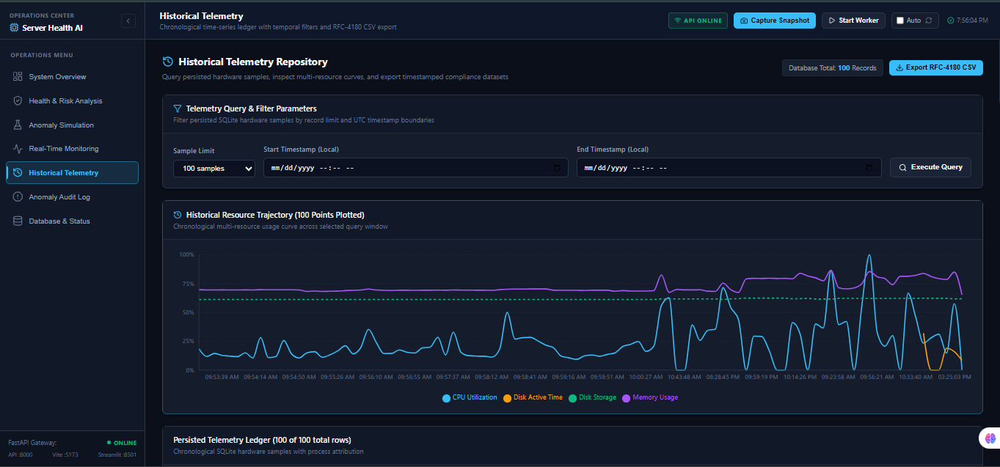
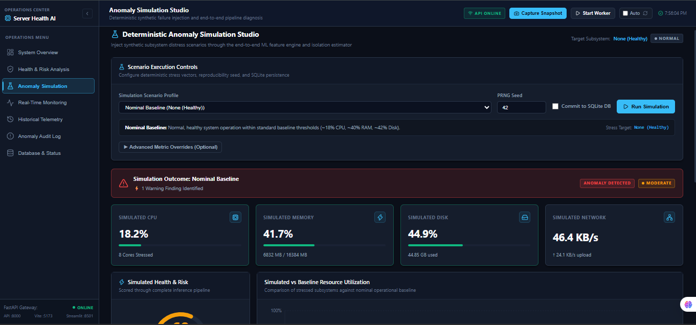
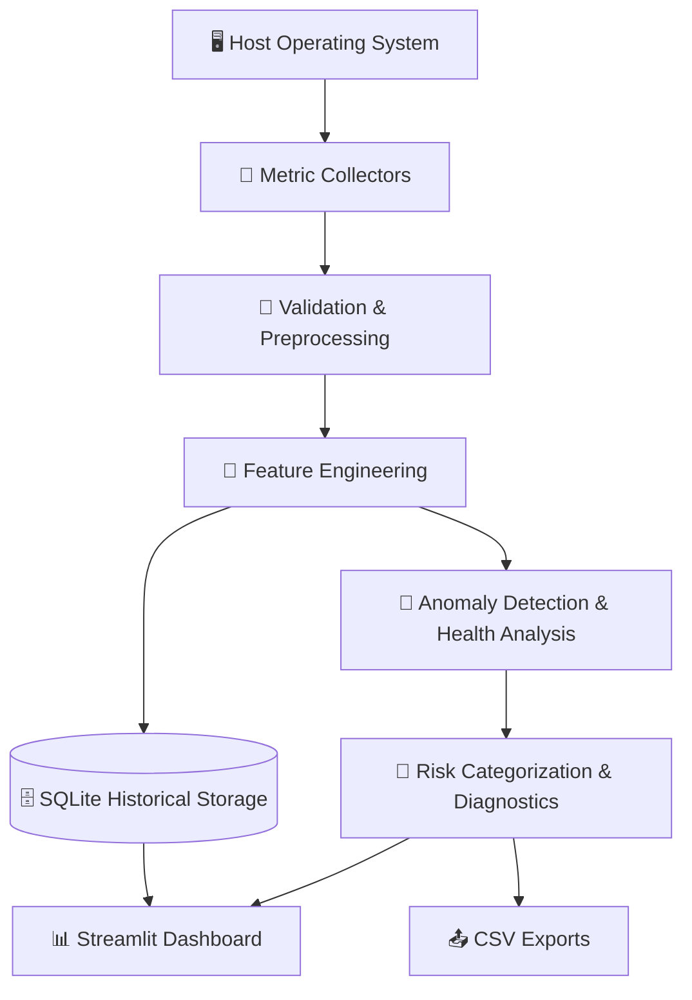

<div align="center">

# 🖥️ AI-Based Predictive System Health Monitoring
### & Failure Risk Analysis

**Collect telemetry. Detect anomalies. Score system health. Understand risk, all in one Streamlit dashboard.**


[Features](#-features) • [Architecture](#-architecture) • [Quick Start](#-quick-start) • [Dashboard](#-dashboard) • [Simulation](#-simulation--diagnostics) • [Limitations](#-scope--limitations) • [Roadmap](#-roadmap)

</div>

---

> [!IMPORTANT]
> **Scope note:** Anomaly detection and resource-based risk indicators describe *observed system behavior*. They do **not** establish a validated probability that a hardware or operating-system failure will occur. Reliable failure prediction requires representative, labeled failure-event data.

## 📖 Overview

**AI-Based Predictive System Health Monitoring and Failure Risk Analysis** is an academic software platform that observes the operational telemetry of a local computer or server, identifies behavioral anomalies, and presents resource-based health and risk indicators.

It collects OS-level metrics (CPU, RAM, disk, network, processes), cleans and validates them, engineers features, scores unusual behavior with machine learning, and visualizes everything in an interactive **Streamlit** dashboard.

It also ships with **deterministic simulation scenarios**, so you can demonstrate how the system reacts to CPU spikes, memory pressure, or disk saturation **without stressing your real machine**.

## 📸 Preview

<!-- Add your screenshots to docs/screenshots/ and update the paths below -->
<div align="center">

| System Overview | Health & Risk Analysis |
| :---: | :---: |
|  |  |

| Historical Telemetry | Simulation & Diagnostics |
| :---: | :---: |
|  |  |

</div>

## ✨ Features

| | Feature | Description |
| :-: | --- | --- |
| 📡 | **Telemetry collection** | CPU, memory, disk, network activity, and running processes via `psutil` |
| 🧹 | **Validation & cleaning** | Handles missing, invalid, and non-finite metric values |
| 🧮 | **Feature engineering** | Rolling statistics, deltas between samples, process usage, and time indicators |
| 🗄️ | **Historical storage** | Metrics, feature vectors, and validation records persisted in SQLite |
| 🤖 | **Anomaly detection** | Isolation Forest flags telemetry that differs from the learned baseline |
| 💯 | **Health score (0–100)** | Deterministic score from anomaly and resource-utilization penalties |
| 🚦 | **Risk categories** | Normal · Low · Moderate · High · Critical |
| 📊 | **Interactive dashboard** | Live metrics, trends, anomaly records, and database inspection |
| ⏱️ | **Live & background monitoring** | One-off snapshots or periodic background collection |
| 🧪 | **Safe simulation** | Synthetic CPU, memory, disk, network, combined-pressure, and baseline scenarios |
| 🔍 | **Explainable diagnostics** | Evidence-based suggestions tied to observed metrics |
| 🩺 | **Operational status** | Component states, worker activity, and telemetry freshness |
| 📤 | **CSV exports** | Download monitoring and diagnostic data for offline analysis |
| 💾 | **Model management** | Save/load artifacts with feature-schema validation and a heuristic fallback |
| ✅ | **Automated testing** | 237 passing tests across the core pipeline |

## 🏗️ Architecture

### Data flow



### Project structure

```text
AI-Based-Server-Health-Monitoring/
├── app/
│   ├── core/             # Configuration and logging
│   ├── models/           # Typed telemetry data models
│   ├── collectors/       # CPU, memory, disk, network, and process metrics
│   ├── preprocessing/    # Validation, cleaning, rolling statistics, features
│   ├── database/         # SQLite schema, migrations, and repositories
│   ├── ml/               # Anomaly detection, simulation, diagnostics
│   ├── dashboard/        # Streamlit pages, charts, components, and services
│   └── utils/            # Shared utilities
├── data/                 # Local telemetry database and data directories
├── models/               # Saved machine learning model artifacts
├── logs/                 # Runtime logs
├── docs/                 # Documentation and review rehearsal guide
├── tests/                # Automated test suite
├── .env.example          # Example environment configuration
├── requirements.txt      # Python dependencies
├── run.py                # Application command-line entry point
└── README.md
```

## 🧰 Tech Stack

| Area | Technology |
| --- | --- |
| Language | Python 3.12+ |
| System metrics | `psutil` |
| Machine learning | `scikit-learn` |
| Data processing | `numpy`, `pandas` |
| Dashboard | `Streamlit` |
| Visualizations | `Plotly` |
| Database | SQLite |
| Model serialization | `joblib` |
| Configuration | `python-dotenv` |
| Testing | `pytest` |

## 🚀 Quick Start

**Requirements:** Python 3.12+ · Windows (current setup is Windows-focused) · Git (optional)

```powershell
# 1. Clone the repository
git clone https://github.com/andhony07/AI-Based-Server-Health-Monitoring.git
cd AI-Based-Server-Health-Monitoring

# 2. Create and activate a virtual environment
python -m venv .venv
.\.venv\Scripts\Activate.ps1

# 3. Install dependencies
python -m pip install --upgrade pip
python -m pip install -r requirements.txt

# 4. Create your local environment file
Copy-Item .env.example .env

# 5. Launch the dashboard
python -m streamlit run app/dashboard/dashboard_main.py
```

Then open **http://localhost:8501** in your browser.

> [!TIP]
> Edit `.env` to change defaults. Never commit secrets or machine-specific sensitive information.

### Command reference

| Goal | Command |
| --- | --- |
| Launch dashboard | `python -m streamlit run app/dashboard/dashboard_main.py` |
| Launch dashboard (alternative, if supported by `run.py`) | `python run.py --dashboard` |
| Continuous monitoring (stop with `Ctrl+C`) | `python run.py` |
| Capture one snapshot | `python run.py --single-shot` |
| Train the anomaly model | `python run.py --train` |
| Run the tests | `pytest` |

> Training uses historical feature vectors stored in SQLite, so a sufficient number of valid samples is required first.

## 📊 Dashboard

| View | What you get |
| --- | --- |
| 🏠 **System Overview** | Current status plus CPU, memory, disk, network, and process metrics |
| ❤️ **Health & Risk Analysis** | Health score, anomaly score, risk category, and score breakdown |
| ⏱️ **Real-Time Monitoring** | On-demand snapshots and background monitoring controls |
| 📈 **Historical Telemetry** | Stored metrics over selectable time ranges |
| 🚨 **Anomaly Audit Log** | Historical anomaly scores and risk categories |
| 🧪 **Simulation & Diagnostics** | Run synthetic scenarios and inspect evidence and recommendations |
| 🩺 **Operational Status** | Component status, worker state, and telemetry freshness |
| 📤 **CSV Export** | Download supported records for offline analysis |
| 🗄️ **Database Inspection** | Record counts, sample timestamps, database size, recent records |

> An idle worker or stale telemetry may simply mean monitoring has not recently collected a sample.

## 🧠 How the Analysis Works

<details>
<summary><b>📡 Collected metrics</b></summary>

- **CPU:** overall utilization and core information
- **Memory:** total, used, available, and utilization
- **Disk:** total, used, free, and utilization
- **Network:** bytes sent/received and throughput
- **Processes:** process count and resource usage of top processes

</details>

<details>
<summary><b>🧮 Feature engineering</b></summary>

The preprocessing pipeline builds a numerical feature vector from current utilization, changes between samples, rolling-window statistics, process usage, time indicators, and flags for missing metric domains. The exact schema is defined by the implementation and must stay consistent with the saved model artifacts.

</details>

<details>
<summary><b>🤖 Machine learning & risk analysis</b></summary>

An **Isolation Forest** identifies telemetry that differs from patterns in the training data. Its anomaly score is shown separately from the **health score** (a deterministic indicator based on configured penalties) and the **risk category** (configured thresholds over current conditions).

These outputs describe observed behavior. They are **not** calibrated probabilities of future failure.

</details>

## 🧪 Simulation & Diagnostics

Deterministic synthetic scenarios for demos and regression testing:

`CPU spike` · `Memory pressure` · `Disk saturation` · `Network saturation` · `Combined resource pressure` · `Normal baseline`

Simulation feeds synthetic telemetry into the analysis pipeline. It **does not** exhaust real host resources or inject OS faults. Diagnostic recommendations are troubleshooting guidance based on available evidence, not proof of a root cause.

## 💾 Data Storage

Telemetry is stored locally in SQLite (default: `data/system_metrics.db`). It holds metric snapshots, engineered feature vectors, and preprocessing validation records. Transactions keep related records consistent, and retention cleanup is supported. The database is local to the machine running the app.

<details>
<summary><b>Check how many samples you have collected</b></summary>

```powershell
python -c "import sqlite3; conn = sqlite3.connect('data/system_metrics.db'); print('Samples:', conn.execute('SELECT COUNT(*) FROM system_metrics').fetchone()[0]); conn.close()"
```

</details>

## ⚙️ Configuration

Settings live in `.env` (see `.env.example`): application metadata, logging, collection intervals, process limits, preprocessing, and database behavior.

## ✅ Testing

```powershell
pytest
```

The latest reported run: **237 passed**. Coverage spans configuration, collectors, preprocessing, database, machine learning, dashboard services, simulation, diagnostics, operational status, CSV export, and integration behavior. Tests verify software behavior; they do not demonstrate predictive accuracy on real hardware failures.

## ⚠️ Scope & Limitations

- Isolation Forest flags deviations from the training baseline; it does not predict failures.
- The health score and risk categories reflect *current observed conditions*.
- Without a trained model or enough history, a heuristic fallback may be used where implemented.
- Simulated scenarios are for demonstration and testing, not authentic hardware-failure events.
- No validated probability or time-to-failure is estimated, since no labeled real-world failure data is used.

A supervised failure-prediction model would need suitable labeled data, a defined prediction horizon, and evaluation on held-out data that avoids temporal leakage.

## 👤 Author

**Andhony Saviyar S** · [@andhony07](https://github.com/andhony07)

---

<div align="center">

⭐ If you find this project useful, consider giving it a star!

</div>
