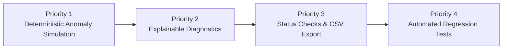

# Upcoming Review Rehearsal & Demonstration Runbook

**Project:** AI-Based Predictive System Health Monitoring and Failure Risk Analysis  
**Topic:** Scope-Restricted Evaluation & Verification Review  
**Test Suite Status:** 237 Passed / 0 Failed / 0 Skipped (35 Test Modules)  
**Required Streamlit Launch Command:**  
```bash
python -m streamlit run app/dashboard/dashboard_main.py
```

---

## 1. Compliance with Scope Restrictions

This implementation strictly adheres to the review scope boundaries:
* ✅ **No real CPU/RAM/disk fault injection**: Purely synthetic, deterministic in-memory simulation generating schema-compliant telemetry and 39 engineered features.
* ✅ **No external messaging integrations**: No Slack, PagerDuty, Twilio, or email hooks implemented during this review cycle.
* ✅ **No multi-model benchmarking**: Focused exclusively on the existing Isolation Forest ML pipeline, transparent health scoring, and heuristic fallback.
* ✅ **No disk-full forecasting**: Prevented unverified time-to-full extrapolation models.
* ✅ **No full UI redesign**: Minimal, targeted view integrations reusing existing dashboard cards, gauges, tables, and color tokens.
* ✅ **Preserved Launch Command**: Launches cleanly via `python -m streamlit run app/dashboard/dashboard_main.py`.

---

## 2. Rehearsal Demonstration Sequence

Follow this exact demonstration order during the review:



---

### Step 1: Pre-Flight Verification & Launch

1. **Verify regression suite**:
   ```bash
   pytest tests/test_ml_simulation.py tests/test_ml_diagnostics.py tests/test_operational_status.py tests/test_csv_export.py
   ```
   *Expected Output:* `30 passed in ~4s`.

2. **Launch Streamlit Dashboard**:
   ```bash
   python -m streamlit run app/dashboard/dashboard_main.py
   ```
   *Expected Output:* Local web server initializes at `http://localhost:8501`.

---

### Step 2: Demonstrate Priority 1 — Safe, Deterministic Anomaly Simulation

1. Open the sidebar navigation in the web browser.
2. Select view: **`🧪 Anomaly Simulation`**.
3. Point out the academic notice:
   > *"Synthetically generates reproducible, physically-valid telemetry anomaly profiles and executes them through the 39-feature preprocessing pipeline and active ML models. Absolutely no physical OS-level fault injection or hardware stress is performed."*
4. Select the scenario profile: **`CPU Thread Runaway / Spike (CPU)`**.
   - Keep seed at `42`.
   - Leave *"Commit Sample to SQLite"* unchecked (Dry-run mode).
   - Click **`🚀 Run Anomaly Simulation`**.
5. **Observe the ML Pipeline Reaction**:
   - **Hardware Telemetry**: CPU utilization spikes deterministically to `~96.5%`, top process `stress_worker` consumes `~90.7%` CPU.
   - **ML Pipeline**: Anomaly score rises above threshold, Composite Health Score degrades, Risk tier advances to `Critical` / `High`.
6. Select scenario profile: **`Memory Exhaustion Leak (Memory (RAM))`**.
   - Click **`🚀 Run Anomaly Simulation`**.
   - Observe RAM utilization at `~95.4%`, top process `leaky_daemon` holding dominant resident memory.
7. Select scenario profile: **`Nominal Baseline (None (Healthy))`**.
   - Click **`🚀 Run Anomaly Simulation`**.
   - Observe nominal metrics (~18% CPU, ~42% RAM), Risk Category `Normal`, Health Score `~90+ / 100`.

---

### Step 3: Demonstrate Priority 2 — Explainable, Evidence-Based Diagnostics

1. While on the **`🧪 Anomaly Simulation`** screen (or switching to **`🛡️ Health & Risk Analysis`**):
2. Scroll to the **`🩺 Explainable Diagnostic Recommendations`** section.
3. Review the **Empirical Evidence Table**:
   - Shows the exact metric signal evaluated (e.g., `cpu_percent`, `top_process_cpu_percent`).
   - Cites the observed telemetry value (e.g., `96.5%`, `stress_worker PID: 1042`).
   - Highlights the reference threshold (e.g., `Critical >= 90.0%`).
   - Explains the significance clearly without opaque AI jargon.
4. Review the **Root-Cause Hypothesis**:
   - Explicitly identifies suspected fault (e.g., *"Runaway thread, infinite compute loop, or intensive compute job in 'stress_worker' (PID: 1042) consuming 90.7% CPU."*).
5. Review the **Prioritized Remediation Guidance**:
   - Shows step-by-step operational actions:
     1. Inspect live process hierarchy via `top`/Task Manager.
     2. Collect thread dumps for the specific runaway PID.
     3. Apply throttling (`renice`) or issue graceful termination signal (`SIGTERM`).

---

### Step 4: Demonstrate Priority 3 — Operational Status Checks & CSV Export

1. Select view: **`🗄️ Database & Operational Status`**.
2. **Review Operational Subsystem Health**:
   - **SQLite Database**: `OPERATIONAL` (Active WAL journal mode, Foreign keys enforced, Quick check integrity `ok`).
   - **ML Model Engine**: `OPERATIONAL` / `FALLBACK` (Reports active model name, 39 features verified).
   - **Hardware Collectors**: `OPERATIONAL` (All 5 telemetry domains accessible).
   - **Telemetry Freshness**: `FRESH` / `WARM` (Reports exact seconds elapsed since last captured sample).
3. **Demonstrate Table CSV Export**:
   - In Table Data Explorer, choose `system_metrics` or `feature_vectors`.
   - Click **`⬇️ Export [table] CSV`**.
   - Verify that the downloaded file contains standard CSV headers with RFC-4180 compliance.
4. Select view: **`📈 Historical Telemetry`**:
   - Click **`⬇️ Export Telemetry CSV`** to export filtered telemetry time horizons.
5. Select view: **`🔍 Anomaly Audit Log`**:
   - Click **`⬇️ Export Audit Log CSV`** to export historical Isolation Forest outlier evaluations.

---

### Step 5: Demonstrate Priority 4 — Regression Test Verification

Run the full automated test suite in the terminal to verify zero regressions:
```bash
pytest
```
*Expected Output:*
```text
======================= 237 passed, 1748 warnings in 59.81s =======================
```

---

## 3. Summary of New Artifacts & Code Deliverables

| File | Purpose |
| :--- | :--- |
| [`app/ml/simulation.py`](file:///e:/DSA/AI-Based%20Server%20Health%20Monitoring/app/ml/simulation.py) | Deterministic anomaly simulator generating reproducible synthetic telemetry scenarios without host stress. |
| [`app/ml/diagnostics.py`](file:///e:/DSA/AI-Based%20Server%20Health%20Monitoring/app/ml/diagnostics.py) | Explainable evidence-based diagnostic engine mapping observations to hypotheses and remediation actions. |
| [`app/dashboard/services/dashboard_service.py`](file:///e:/DSA/AI-Based%20Server%20Health%20Monitoring/app/dashboard/services/dashboard_service.py) | Extended with operational status inspection, simulation coordination, and RFC-4180 CSV export. |
| [`app/dashboard/components/metrics_cards.py`](file:///e:/DSA/AI-Based%20Server%20Health%20Monitoring/app/dashboard/components/metrics_cards.py) | Robust telemetry schema adapter (`adapt_telemetry_to_record`) supporting `SystemMetrics`, `SystemMetricRecord`, and dictionaries. |
| [`app/dashboard/components/diagnostic_card.py`](file:///e:/DSA/AI-Based%20Server%20Health%20Monitoring/app/dashboard/components/diagnostic_card.py) | Reusable visual card component rendering empirical evidence tables and remediation steps. |
| [`app/dashboard/dashboard_main.py`](file:///e:/DSA/AI-Based%20Server%20Health%20Monitoring/app/dashboard/dashboard_main.py) | Interactive Streamlit integration for Anomaly Simulation, Diagnostics, Status checks, and CSV download buttons. |
| [`tests/test_ml_simulation.py`](file:///e:/DSA/AI-Based%20Server%20Health%20Monitoring/tests/test_ml_simulation.py) | 11 unit tests covering determinism, physical bounds, sequence generation, and ML pipeline integration. |
| [`tests/test_ml_diagnostics.py`](file:///e:/DSA/AI-Based%20Server%20Health%20Monitoring/tests/test_ml_diagnostics.py) | 9 unit tests covering rule triggers, evidence extraction, remediation steps, and JSON serialization. |
| [`tests/test_operational_status.py`](file:///e:/DSA/AI-Based%20Server%20Health%20Monitoring/tests/test_operational_status.py) | 5 unit tests covering database integrity check, ML readiness, telemetry freshness, and worker status. |
| [`tests/test_csv_export.py`](file:///e:/DSA/AI-Based%20Server%20Health%20Monitoring/tests/test_csv_export.py) | 5 unit tests covering RFC-4180 formatting, 39-feature headers, time filtering, and empty dataset handling. |
| [`tests/test_dashboard_components.py`](file:///e:/DSA/AI-Based%20Server%20Health%20Monitoring/tests/test_dashboard_components.py) | 8 unit tests covering telemetry model adaptation, missing field resilience, and simulated badge rendering. |
| [`tests/test_dashboard_service.py`](file:///e:/DSA/AI-Based%20Server%20Health%20Monitoring/tests/test_dashboard_service.py) | 4 integration tests covering simulation pipeline coordination, persistence toggling, and diagnostics correlation. |
